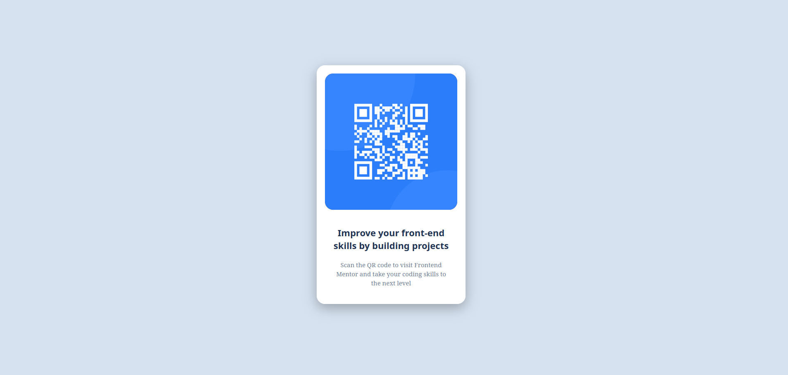

# Frontend Mentor - QR code component solution

Esta é uma solução para o [desafio do componente de QR code no Frontend Mentor](https://www.frontendmentor.io/challenges/qr-code-component-iux_sIO_H). Os desafios do Frontend Mentor ajudam a aprimorar suas habilidades de codificação construindo projetos reais.

## Sumário

- [Visão Geral](#visão-geral)
  - [O desafio](#o-desafio)
  - [Captura de tela](#captura-de-tela)
  - [Links](#links)
- [Meu processo](#meu-processo)
  - [Tecnologias utilizadas](#tecnologias-utilizadas)
  - [O que aprendi](#o-que-aprendi)
  - [Desenvolvimento contínuo](#desenvolvimento-contínuo)
  - [Recursos úteis](#recursos-úteis)
  - [Colaboração com IA](#colaboração-com-ia)
- [Autor](#autor)
- [Agradecimentos](#agradecimentos)

## Visão Geral

### O desafio

Os usuários devem ser capazes de:

- Visualizar o layout ideal para o componente, dependendo do tamanho da tela do dispositivo.
- Ver os estados de foco (hover e focus) para todos os elementos interativos na página (se aplicável).

### Captura de tela

### Links

- URL da Solução: [Cole o link do seu repositório no GitHub aqui](https://github.com/AlineRodrigues02/QR-code-component.git)
- URL do Site ao Vivo: [Cole o link do site no ar (Vercel, Netlify, GitHub Pages) aqui](https://alinerodrigues02.github.io/QR-code-component/)

### Autor
GitHub - AlineRodrigues02

### Tecnologias utilizadas

- HTML5 semântico
- Propriedades customizadas do CSS (CSS Variables)
- Flexbox
- Fluxo Mobile-first

